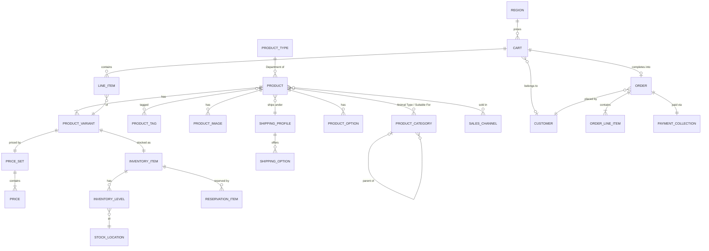

# Domain Model

This document defines the language and the data model of the reptile and
exotic-pet store. It maps the business's terms onto **Medusa v2**, which owns
all commerce data (products, prices, inventory, carts, orders, customers, and
staff users). The product catalogue is based on
[`ProductData.json`](../ProductData.json).

Read it alongside [`CLAUDE.md`](../CLAUDE.md). Where this document and
`CLAUDE.md` disagree, flag it. Don't pick one silently.

**Scope**: single tenant, guest checkout only, one region (United States,
USD). No customer accounts, real payment provider, tax, or email yet.

---

## 1. Glossary

Use these terms in code, docs, and conversation. Each one names the Medusa
entity it maps to.

### Catalogue

| Term | Meaning | Medusa entity |
|---|---|---|
| **Product** | Something the store sells, with one page in the storefront. | `Product` |
| **Variant** | The purchasable unit of a Product. It carries the SKU, price, and stock. Most Products have exactly one. | `ProductVariant` |
| **Department** | The top-level grouping: **Live Animals**, **Feeders**, **Enclosures**, or **Accessories**. Every Product has exactly one. | `ProductType` |
| **Animal Type** | A node in the nested animal taxonomy, e.g. Lizard → Gecko → Crested Gecko. | `ProductCategory` (tree) |
| **Live Animal** | A Product in the Live Animals Department. Feeders are *not* Live Animals, even when they are alive (crickets, dubia roaches). | `Product` with type `live-animals` |
| **Supply** | Any Product that is not a Live Animal: Feeders, Enclosures, and Accessories. | `Product` |
| **Suitable For** | The Animal Types a Supply is meant for. Stored as its Animal Type assignments. | `Product` ↔ `ProductCategory` |
| **Care Level** | How much experience a Live Animal needs: `beginner-friendly`, `intermediate`, or `advanced`. These three are reserved Tags. | `ProductTag` |
| **Tag** | A free-form, filterable label such as `nocturnal` or `arboreal`. Always lowercase-kebab. | `ProductTag` |
| **Care Sheet** | An external URL with husbandry guidance for a Product. | `product.metadata.care_sheet_url` |
| **Video** | An external video URL shown on the product page. | `product.metadata.video_urls` |
| **Care Guides** | The storefront page that collects every Live Animal's Care Sheet and Videos by Animal Type. It is a view of existing data, not a separate thing. | — (reads `Product`) |
| **SKU** | The staff-facing stock code of a Variant, e.g. `la-001`. | `ProductVariant.sku` |
| **Handle** | The URL slug of a Product, e.g. `crested-gecko`. | `Product.handle` |

### Stock

| Term | Meaning | Medusa entity |
|---|---|---|
| **Stock Location** | The single place the business holds stock. | `StockLocation` |
| **Inventory Item** | The stock-tracked thing behind a Variant. | `InventoryItem` |
| **Stock** | The quantity of an Inventory Item at the Stock Location. | `InventoryLevel.stocked_quantity` |
| **Reservation** | Stock held for an order that hasn't been fulfilled yet. | `ReservationItem` |
| **Available Stock** | Stock minus Reservations. This is the cap on cart quantity. | derived by Medusa |

### People

| Term | Meaning | Medusa entity |
|---|---|---|
| **Customer** | A person who buys from the storefront. Guest checkout creates or reuses a Customer by email, with `has_account = false`. | `Customer` |
| **Staff User** | A person who works in Medusa Admin. Every Staff User currently has full Admin access. | `User` |

### Shopping and orders

| Term | Meaning | Medusa entity |
|---|---|---|
| **Region** | The market a cart is priced in. There is one: United States, USD. | `Region` |
| **Sales Channel** | Where products are sold. There is one: the storefront. | `SalesChannel` |
| **Cart** | A Customer's in-progress selection, before checkout. | `Cart` |
| **Line Item** | One Variant and its quantity in a Cart or Order. | `LineItem` / `OrderLineItem` |
| **Order** | A completed checkout. | `Order` |
| **Shipping Profile** | A group of Products that ship under the same rules. | `ShippingProfile` |
| **Shipping Option** | A way to ship that the Customer picks at checkout. | `ShippingOption` |
| **Payment** | Payment through Medusa's built-in system (manual) provider. | `PaymentCollection`, `PaymentSession`, `Payment` |

### Terms to avoid

- **"Category" on its own.** `CLAUDE.md` uses "category" for the Department
  (live animals, feeders, enclosures, accessories). Medusa's
  `ProductCategory` holds the Animal Type. Always say **Department** or
  **Animal Type**.
- **"Account" or "user" for shoppers.** Say **Customer**. "User" means a
  **Staff User**.
- **"Species"** as a model term. Not every Animal Type leaf is a species
  (e.g. Tree Frog, Tarantula). Say **Animal Type**.

---

## 2. Entity model

Medusa v2 modules in use: Product, Pricing, Inventory, Stock Location, Sales
Channel, Region, Cart, Order, Customer, User, Payment, Fulfillment. No custom
modules are needed for the current scope.



Staff Users (`User`) are not linked to commerce records. They act on them
through Medusa Admin.

### Animal Type tree

This is the tree implied by the seed data. Each leaf in **bold** is the
Animal Type of at least one Live Animal.

```
Lizard
├── Skink
│   └── **Blue-Tongued Skink**
├── Gecko
│   ├── **Crested Gecko**
│   └── **Gargoyle Gecko**
└── Tegu
    ├── **Argentine Black and White Tegu**
    └── **Red Tegu**
Snake
├── Python
│   └── **Ball Python**
└── Colubrid
    ├── **Corn Snake**
    └── **Hognose Snake**
Amphibian
├── Frog
│   ├── **Tree Frog**
│   └── **Horned Frog**
└── Salamander
    └── **Axolotl**
Invertebrate
└── Arachnid
    ├── **Tarantula**
    └── **Scorpion**
```

Names use title case in the tree. The seed data's lowercase names and the
mixed-case "Argentine black and white tegu" map onto these nodes.

---

## 3. Mapping `ProductData.json` to Medusa

Each JSON entry becomes **one Product with one default Variant**. The one
exception is described below the table.

| JSON field | Medusa target | Rule |
|---|---|---|
| `id` | `ProductVariant.sku` | Copied as-is, e.g. `la-001`. The prefix tells staff the Department (`la` Live Animals, `f` Feeders, `e` Enclosures, `a` Accessories). Medusa generates its own `prod_…` and `variant_…` ids. |
| `name` | `Product.title` | Copied as-is. |
| — | `Product.handle` | Slug of `name`, e.g. `northern-blue-tongued-skink`. |
| `description` | `Product.description` | Copied as-is. |
| `category` | `Product.type` (Department) | `live-animals`, `feeders`, `enclosures`, `accessories` → four ProductTypes. |
| `animalCategory` | `Product.categories` (Animal Types) | Apply the **most-specific-node rule** below. |
| `price` | `Price` on the Variant's price set | One USD price, in major units (Medusa v2 stores amounts this way: `199.99` is $199.99). |
| `stock` | `InventoryLevel.stocked_quantity` | At the single Stock Location. |
| `imageUrl` | `Product.thumbnail` and the first `ProductImage` | |
| `careSheet` | `Product.metadata.care_sheet_url` | Present on Live Animals only. |
| `video` | `Product.metadata.video_urls` | An array. Present on Live Animals only. |
| `tags` | `Product.tags` | Normalized to lowercase-kebab (`UVB` → `uvb`, `New-Caledonia` → `new-caledonia`, `BSFL` → `bsfl`). |

### Most-specific-node rule

`animalCategory` lists a path through the tree, not a set of assignments.
A parent appears only to show where its children sit. So:

> Assign a Product to each listed node that has **no listed descendant**.

Browsing an Animal Type includes Products assigned to its descendants.

- A Live Animal ends up with exactly one Animal Type, its leaf.
  `la-003` `["lizard", "gecko", "crested gecko"]` → **Crested Gecko**.
- A Supply ends up with each node it suits.
  `a-001` lists `lizard, skink, tegu, snake, colubrid, corn snake,
  hognose snake, amphibian, frog, tree frog, horned frog, salamander,
  axolotl` → **Skink, Tegu, Corn Snake, Hognose Snake, Tree Frog, Horned
  Frog, Axolotl**.
- A listed node with no listed children means "all of this group".
  `a-020` lists `gecko` with no gecko species → **Gecko** (all geckos).

### Variant exception: e-003

`e-003` (PVC Reptile Enclosure 4'x2'x2') is "available in black or white".
It gets a **Color** option with two Variants, **Black** and **White**. SKUs
must be unique, so they are **`e-003-black`** and **`e-003-white`**, the one
exception to copying `id` as-is. The seed splits its stock of 7 as **4 Black
/ 3 White**, a placeholder until the split is decided (section 5).

### Seed corrections

- `la-001` (Northern Blue-Tongued Skink): Care Level changes from
  `beginner-friendly` to **`intermediate`**, to match its description
  ("an excellent choice for intermediate reptile keepers").
- All tags are normalized as described above. Tags that repeat an Animal
  Type or Department (e.g. `gecko`, `axolotl`, `enclosure`) are kept.

---

## 4. Business rules

1. **No overselling.** Every Variant has `manage_inventory = true` and
   `allow_backorder = false`. Cart quantity can never exceed Available Stock.
   This applies to all Products, not just Live Animals.
2. **One Care Level per Live Animal.** Each Live Animal has exactly one of
   `beginner-friendly`, `intermediate`, or `advanced`. Supplies have none.
   The storefront shows it prominently.
3. **Live Animals are fungible.** Stock is a count of interchangeable
   animals. The customer gets any one of them, not a specific individual.
4. **One of each.** One Region (United States, USD), one Sales Channel (the
   storefront), and one Stock Location.
5. **Live Animal shipping is unresolved.** Supplies use the default Shipping
   Profile. Live Animals use a separate **Live Animals** Shipping Profile
   with **no Shipping Options defined**. That is a placeholder, not a rule.
   Until a human decides the shipping, legal, permit, and age rules, Live
   Animals cannot complete checkout.
6. **Manual payment only.** Payment goes through Medusa's system (manual)
   provider, behind the Payment module.
7. **Guest Customers.** Checkout creates or reuses a Customer by email with
   `has_account = false`. Accounts come later on the same Customer record.
8. **Flat staff permissions.** Every Staff User has full Admin access,
   including deleting products and managing other Staff Users.
9. **The storefront never computes commerce data.** Prices, totals, tax,
   and stock come from Medusa.

---

## 5. Open questions

These need a human decision before they are modeled.

- **Live Animal shipping, legal, permit, and age rules.** Until they're
  decided, Live Animals can't be checked out (rule 5).
- **e-003 stock split** between the Black and White Variants. The seed uses
  4 Black / 3 White as a placeholder. Staff can correct it in Admin.
- **Individual animals.** Will the store ever sell specific animals with
  their own sex, hatch date, or photos? That would mean one Variant per
  animal with stock 1.
- **Morphs and sizes as Variants.** Ball Python and Pastel Ball Python, or
  Small and Large Dubia, are separate Products today. Should any be grouped
  into one Product with Variants later?
- **Inventory flags set by staff.** Rule 1 relies on every Variant having
  `manage_inventory` on and `allow_backorder` off. Nothing stops a Staff User
  from creating a Variant in Admin with those flags wrong, and the integration
  tests only prove Medusa enforces the rule for correctly flagged Variants.
  Does the rule need an enforcing hook?
- **Staff roles.** Does any Staff User need restricted access? Changing that
  touches auth and needs sign-off.
- **Product images.** Seed `imageUrl`s are hotlinked from Wikimedia, and
  some look made up and may not resolve. `CLAUDE.md` says file storage is
  local in development and S3 in production. Should images be rehosted
  through Medusa's File module?
- **Care content editing.** Care Sheets and Videos live in product metadata,
  which staff edit with Admin's raw metadata editor. Is a dedicated Admin
  widget wanted later?
- **Customer accounts.** Out of scope now. They will extend the existing
  Customer record.
